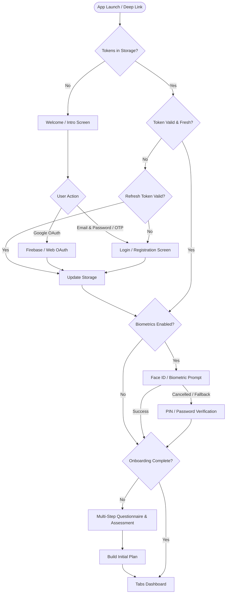
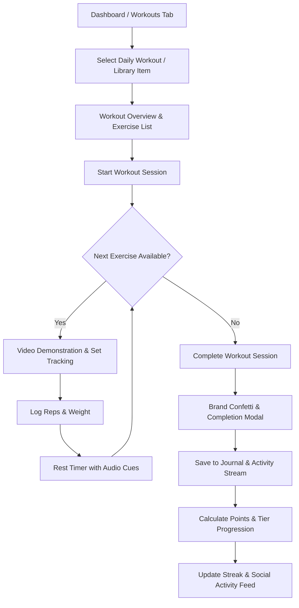
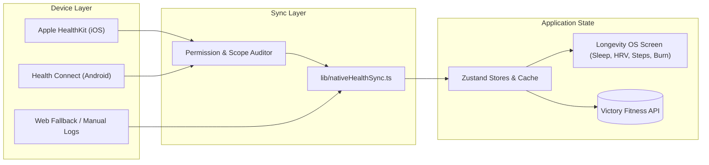

# Victory Fitness App (Victora)

> A performance-first cross-platform wellness, training, and Longevity OS application built with **React Native**, **Expo SDK 54**, and **Expo Router v6**. Designed for iOS, Android, and Web (Progressive Web App).

---

## 📑 Table of Contents

- [Overview](#overview)
- [Architecture & Flow Diagrams](#architecture--flow-diagrams)
  - [1. User Authentication & Session Recovery Flow](#1-user-authentication--session-recovery-flow)
  - [2. Daily Training & Workout Lifecycle](#2-daily-training--workout-lifecycle)
  - [3. Health & Longevity OS Synchronization](#3-health--longevity-os-synchronization)
- [Key Features](#key-features)
- [Tech Stack](#tech-stack)
- [Folder Structure](#folder-structure)
- [Environment Configuration](#environment-configuration)
- [Getting Started](#getting-started)
- [Available Scripts](#available-scripts)
- [Build & Deployment](#build--deployment)
  - [PWA / Web Deployment (Vercel)](#pwa--web-deployment-vercel)
  - [Native Mobile Builds (EAS Build)](#native-mobile-builds-eas-build)
- [Security & Device Permissions](#security--device-permissions)
- [Testing](#testing)
- [License](#license)

---

## Overview

**Victory Fitness** is a full-featured fitness and lifestyle companion designed to maximize adherence and longevity. It balances guided strength and conditioning routines, intelligent nutrition planning, wearable-based recovery insights, and social accountability mechanics (Duo partnerships, cohort-based challenges, and community chat).

---

## Architecture & Flow Diagrams

### 1. User Authentication & Session Recovery Flow



---

### 2. Daily Training & Workout Lifecycle



---

### 3. Health & Longevity OS Synchronization



---

## Key Features

- **Adaptive Training Engine**:
  - Structured workout splits and strength builder wizards.
  - Interactive workout execution screen with set logging, exercise swaps, video guides, and audio-cued rest timers.
- **Longevity OS & Recovery Analytics**:
  - Real-time aggregation of steps, active calories, sleep duration, resting heart rate, and HRV.
  - Wearables sync status, habit completion digests, and personalized health guidance.
- **Smart Nutrition & Meal Planning**:
  - Day-by-day and 7-day meal plan views with comprehensive macronutrient breakdowns.
  - Interactive grocery shopping list generator, AI-assisted meal analysis, and hydration tracking.
- **Social & Accountability**:
  - **Duo Partner Pairing**: Real-time workout check-ins and mutual streak reminders.
  - **Challenges & Cohorts**: Goal-oriented community challenges with participant leaderboards and dedicated discussion chats.
  - **Victor AI Coach**: Dynamic motivational suggestions and quick interactive coaching prompts.
- **Security & Multi-Platform Identity**:
  - Biometric quick-unlock (Face ID / Touch ID / Android BiometricPrompt).
  - Google Identity Services & Firebase Web Push integration.
  - Multi-language support (English, German, French, Spanish, Italian, Dutch, Portuguese, Bengali).

---

## Tech Stack

| Domain | Technology / Library |
| --- | --- |
| **Core Framework** | [React Native 0.81](https://reactnative.dev/), [React 19](https://react.dev/) |
| **Platform & SDK** | [Expo SDK 54](https://docs.expo.dev/) (New Architecture Enabled) |
| **Routing** | [Expo Router v6](https://docs.expo.dev/router/introduction/) |
| **State Management** | [Zustand](https://github.com/pmndrs/zustand) |
| **Local Storage** | `@react-native-async-storage/async-storage` |
| **Biometrics & Security** | `expo-local-authentication`, `jose` |
| **Health Integrations** | `react-native-health` (HealthKit), `react-native-health-connect` (Health Connect) |
| **Audio & Media** | `expo-audio`, `expo-image-picker`, `expo-sharing`, `react-native-webview` |
| **Push Notifications** | `expo-notifications`, Firebase Web Push, Service Worker |
| **UI Components & Icons** | `expo-linear-gradient`, `@expo/vector-icons`, Inter & Clash Display typography |
| **Web Target** | Metro Web Bundler, static export, PWA manifest and service worker |

---

## Folder Structure

```text
victory-fitness-app/
├── app/                              # Expo Router file-based route definitions
│   ├── (auth)/                       # Authentication screens (login, register, welcome, verify)
│   ├── (tabs)/                       # Main bottom navigation tabs
│   │   ├── index.tsx                 # Home dashboard & daily overview
│   │   ├── workout.tsx               # Training routines & quick launch
│   │   ├── mealPlan.tsx              # Nutrition & daily meal tracking
│   │   ├── challenge.tsx             # Active challenges & leaderboard
│   │   └── profile.tsx               # User account, stats & settings
│   ├── admin/                        # Administrative tools & challenge management
│   ├── challenges/                   # Challenge detail, progress cards & challenge feed
│   ├── chat/                         # Community and direct messaging
│   ├── duo/                          # Accountability partner screens
│   ├── journal/                      # Workout history & progress logs
│   ├── mealPlan/                     # Weekly meal breakdown & grocery planner
│   ├── onboard/                      # Assessment & goal onboarding survey
│   ├── profile/                      # Settings, Longevity OS, terms & privacy
│   ├── workout-library/              # Categorized exercise library
│   ├── workoutplan/                  # Custom split generators & routine wizard
│   ├── _layout.tsx                   # Root navigation stack and providers
│   └── +html.tsx                     # Web HTML shell customization
├── assets/                           # Visual assets, branding icons, fonts & sounds
├── components/                       # Modular UI components
│   ├── audit/                        # Access restriction & audit boundaries
│   ├── challenge/                    # Challenge cards, cohort modals & feeds
│   ├── chat/                         # Interactive coach & chat bubbles
│   ├── confetti/                     # Completion celebration effects
│   ├── duo/                          # Partner invite and match dialogs
│   ├── home/                         # Dashboard cards (streak, water, activity, coach)
│   ├── nutrition/                    # Macro widgets, meal modals & grocery lists
│   ├── profile/                      # Habit widgets, wearables sync & account management
│   └── workout/                      # Exercise timers, video players & workout grid
├── constants/                        # Global style constants, colors, typography tokens
├── context/                          # React context providers (theme, session)
├── hooks/                            # Custom hooks (screen preloading, debounce, state)
├── lib/                              # Core business logic and integrations
│   ├── access.ts                     # Tier entitlements & permission guard logic
│   ├── api.ts                        # HTTP & WebSocket API client
│   ├── biometricUnlock.ts            # Hardware biometric verification
│   ├── domainContext.ts              # Domain and locale resolver
│   ├── firebaseGoogleAuth.ts         # Google Sign-In & token handling
│   ├── firebaseWebPush.ts            # Web push messaging & registration
│   ├── i18n.ts                       # Multi-language internationalization
│   ├── nativeHealthSync.ts           # Apple HealthKit & Android Health Connect drivers
│   ├── navigation.ts                 # Type-safe router wrappers
│   └── workout-plans.ts              # Routine and split computation logic
├── public/                           # Static assets, legal documents, manifest & SW
├── scripts/                          # PWA optimization & localization audit scripts
└── tests/                            # Node.js automated test suites
```

---

## Environment Configuration

Create a `.env` file in the project root:

```bash
cp .env.example .env
```

| Key | Description | Default / Example |
| --- | --- | --- |
| `EXPO_PUBLIC_API_URL` | Backend REST/WebSocket base URL | `https://api.yourdomain.com` |
| `EXPO_PUBLIC_GOOGLE_WEB_CLIENT_ID` | Google OAuth Client ID for Web | `your-web-id.apps.googleusercontent.com` |
| `EXPO_PUBLIC_GOOGLE_ANDROID_CLIENT_ID` | Google OAuth Client ID for Android | `your-android-id.apps.googleusercontent.com` |
| `EXPO_PUBLIC_GOOGLE_IOS_CLIENT_ID` | Google OAuth Client ID for iOS | *(Optional)* |
| `EXPO_PUBLIC_FIREBASE_API_KEY` | Firebase Web API Key | `AIzaSy...` |
| `EXPO_PUBLIC_FIREBASE_PROJECT_ID` | Firebase Project ID | `your-project-id` |
| `EXPO_PUBLIC_FIREBASE_VAPID_KEY` | Web Push VAPID Public Key | `BEl6...` |

---

## Getting Started

### Prerequisites

- **Node.js**: v18.x or v20.x
- **Package Manager**: npm or yarn
- **Expo Go** on your physical mobile device, or **Android Studio** / **Xcode** simulators.

### Installation

```bash
# 1. Install dependencies
npm install

# 2. Run local development server
npm start
```

Press `a` in the terminal for Android, `i` for iOS simulator, or `w` for Web.

---

## Available Scripts

| Script | Purpose |
| --- | --- |
| `npm start` | Launches the interactive Expo Metro development server |
| `npm run android` | Starts the app on a connected Android device / emulator |
| `npm run ios` | Starts the app on an iOS simulator (macOS required) |
| `npm run web` | Launches the web version in your default browser |
| `npm run build:web` | Exports static web assets, optimizes bundles, and builds PWA service workers |

---

## Build & Deployment

### PWA / Web Deployment (Vercel)

The web target is configured as an installable Progressive Web App with caching and push notifications.

1. **Build the bundle**:
   ```bash
   npm run build:web
   ```
2. **Deploy with Vercel**:
   - The included [`vercel.json`](file:///d:/VICTORA/victory-fitness-app/vercel.json) configures single-page application routes and caching headers.
   - Build Command: `npm run build:web`
   - Output Directory: `dist`
   - Preset: `Other`

### Native Mobile Builds (EAS Build)

Ensure [EAS CLI](https://docs.expo.dev/build/introduction/) is installed:

```bash
npm install -g eas-cli
eas login
```

Build commands configured in [`eas.json`](file:///d:/VICTORA/victory-fitness-app/eas.json):

```bash
# Build Android APK / AAB
eas build --platform android --profile preview

# Build iOS Archive
eas build --platform ios --profile preview
```

---

## Security & Device Permissions

- **Biometric Security**: Protects existing user sessions using `expo-local-authentication`. Biometric signatures never leave the device hardware enclave.
- **Apple HealthKit (`NSHealthShareUsageDescription`)**: Read-only scopes for active calories, heart rate, resting energy, steps, and sleep analysis.
- **Health Connect**: Granular read/write permissions for Android Health Connect APIs.
- **Microphone & Audio**: Used for rest timers and audio workouts.

---

## Testing

Automated test suites can be run using Node's native test runner:

```bash
# Test subscription gates, onboarding access, and route recovery
node --test tests/access.test.mjs

# Test service worker caching and API bypass behavior
node --test tests/service-worker.test.mjs
```

Type checking:
```bash
npx tsc --noEmit
```

---

## License

This repository and all associated assets are proprietary and confidential. Unauthorized copying, distribution, or reproduction is strictly prohibited.
